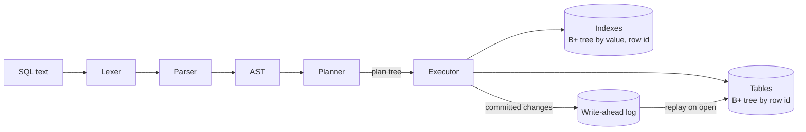

# MiniDB

A small relational database engine written from scratch in Java 21, with no dependencies outside the JDK.
It parses SQL, stores rows and indexes in B+ trees, picks a query plan, and keeps data safe on disk with a write-ahead log.

The goal is to show, in code small enough to read in an afternoon, what happens inside MySQL or PostgreSQL when a query runs: how an index turns a full scan into a lookup, how a join is executed, and how a database survives a crash in the middle of a write.

```
minidb> CREATE TABLE users (id INT PRIMARY KEY, name TEXT NOT NULL, age INT);
minidb> CREATE INDEX idx_age ON users(age);
minidb> INSERT INTO users VALUES (1, 'An', 22), (2, 'Binh', 30), (3, 'Chi', 27);
minidb> EXPLAIN SELECT name FROM users WHERE age >= 25 AND name != 'X';
+-----------------------------------------------------------+
| plan                                                      |
+-----------------------------------------------------------+
| Project name                                              |
|   -> Filter ((age >= 25) AND (name != 'X'))               |
|     -> IndexRange users using idx_age (age in [25, +inf)) |
+-----------------------------------------------------------+
```

## Features

| Area | What is implemented |
|---|---|
| SQL | `CREATE TABLE`, `CREATE [UNIQUE] INDEX`, `DROP TABLE`, `INSERT` (multi-row), `SELECT`, `UPDATE`, `DELETE`, `EXPLAIN`, `VACUUM`, `SHOW TABLES` |
| Queries | `WHERE` with `AND / OR / NOT`, `IS [NOT] NULL`, arithmetic, `INNER JOIN ... ON`, `ORDER BY` (multi-column, `ASC/DESC`), `LIMIT`, `COUNT(*)`, column aliases |
| Types | `INT` (64-bit), `TEXT`, `NULL` with SQL three-valued logic |
| Constraints | `PRIMARY KEY`, `NOT NULL`, `UNIQUE` index, type checks |
| Storage | Clustered B+ tree per table, B+ tree secondary indexes |
| Planner | Index lookup / index range scan / full scan; index nested-loop, hash and nested-loop joins |
| Durability | Write-ahead log with CRC32 checksums, torn-write recovery, atomic log compaction |
| Atomicity | Every statement is all-or-nothing (undo log) |

## Architecture



| Package | Responsibility |
|---|---|
| `sql` | Hand-written lexer and recursive-descent parser producing an AST (Java records + sealed interfaces) |
| `index` | Generic `BPlusTree<K, V>` with insert, delete (borrow / merge), point and range search |
| `storage` | `Table`, `Index`, the write-ahead log and its binary record format |
| `exec` | Expression compiler, plan operators, rule-based planner |
| root | `Database` (statement execution, undo log) and the interactive shell |

## How it works

### B+ tree (`index/BPlusTree.java`)

All keys live in leaves; internal nodes only route searches. Leaves are linked, so a range query descends once (`O(log n)`) and then walks the leaf chain (`O(k)` for `k` results).

- **Insert**: a full leaf splits in half and copies its first right-hand key up as the separator; a full internal node splits and moves its middle key up. If the root splits, the tree grows by one level.
- **Delete**: an underfull node first borrows a key from a sibling that can spare one, otherwise merges with a sibling and pulls the separator down. If the root is left with one child, the tree shrinks by one level.
- Tested with a property test: 20,000 random inserts and deletes compared against `java.util.TreeMap`, with every structural invariant checked (key order, node fill, equal leaf depth, separator bounds), for orders 3, 4, 5, 8 and 64.

Each table stores rows in a B+ tree keyed by row id. A secondary index is a B+ tree keyed by `(value, rowId)`: adding the row id makes every key unique even when many rows share a value, and all rows with one value form a contiguous range.

### Query planner (`exec/Planner.java`)

A rule-based planner, similar in spirit to early versions of SQLite:

1. Split `WHERE` into `AND`-ed conditions. For each `column op constant` on an indexed column, score it: equality on a unique index (3) > equality (2) > range (1). `5 < age` is flipped to `age > 5`.
2. Several range conditions on the chosen column are merged into one interval, e.g. `age >= 18 AND age < 30 AND age > 10` becomes `[18, 30)`.
3. For a join `ON a.x = b.y`: use an **index nested-loop join** if `b.y` is indexed (`O(n log m)`), otherwise a **hash join** (`O(n + m)`), and fall back to a **nested-loop join** (`O(n·m)`) when the condition is not an equality.
4. The full `WHERE` is still applied as a filter above the scan, so choosing an index can only change speed, never results. A test runs the same queries before and after creating an index and checks the results are identical.

### Write-ahead log (`storage/WriteAheadLog.java`)

The database file is an append-only log. Each successful statement becomes one record:

```
[int payload length][long CRC32 of payload][payload: list of changes]
```

- **Recovery**: on open, records are replayed in order. If the last record is short (the process died mid-write) or its checksum does not match, it is discarded and the file is truncated back to the last complete record. A statement is therefore either fully applied or not at all.
- **Compaction** (`VACUUM`): the log of a long-running database grows with every update. `VACUUM` writes a snapshot of the current tables to a temporary file, `fsync`s it, and renames it over the log. A rename is atomic on POSIX file systems, so a crash leaves either the old file or the new one.
- `fsync` after every commit is on by default in the shell and can be turned off for tests.

### Atomic statements (`Database.commit`)

Changes are applied one at a time while an undo list records the inverse of each (insert ↔ delete, update ↔ update with old values). If a change fails, for example a duplicate primary key on the third row of an `INSERT`, the applied changes are undone in reverse order and nothing is written to the log.

## Run it

Requires JDK 21 and Maven.

```bash
mvn package
java -jar target/minidb.jar shop.db
```

Run the tests:

```bash
mvn test
```

## Limitations

These are deliberate scope limits, not bugs:

- One statement at a time (the `Database` methods are `synchronized`); no multi-statement transactions, no MVCC.
- The whole database is loaded into memory on open; the B+ trees are not paged to disk.
- Operators materialize their full result instead of streaming rows (no Volcano iterator model).
- No `GROUP BY`, outer joins, subqueries or cost-based optimization.

## Key ideas

- Why `NULL = NULL` is not true, and how three-valued logic changes `WHERE`, `NOT` and joins.
- Why a secondary index stores the row id next to the value.
- The trade-off between hash join and index nested-loop join, and why the planner needs to know which indexes exist.
- How a checksum plus a length prefix is enough to make appends crash-safe.
